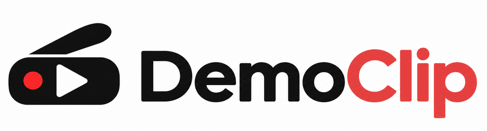

<h1>
  
</h1>

**🚀 Live App**: [https://acs.github.io/democlip/](https://acs.github.io/democlip/)

Capture. Create. Share.

DemoClip is a lightweight video studio that runs entirely in your browser. Record your screen, webcam or microphone — independently or in any combination — to create software demos, tutorials or personal video updates.

Review your recordings, make quick cuts, point at what matters with an arrow or a picture, and publish directly to Bluesky or YouTube. Or simply export your video to a file.

No installation. No recording server. Just open DemoClip and start creating.

[](https://www.typescriptlang.org/)
[](https://vite.dev/)
[](https://vitest.dev/)
[](https://eslint.org/)
[](https://developer.mozilla.org/en-US/docs/Web/API/WebCodecs_API)
[](https://mediabunny.dev/)
[](https://web.dev/progressive-web-apps/)
[](https://atproto.com/)

A minute and a half of DemoClip recording, cutting and exporting a clip — recorded with DemoClip itself:

https://github.com/user-attachments/assets/81f83dc4-a036-4e10-a398-b36ceca93122

---

## Features

The headline capabilities; the **[full list is in FEATURES.md](FEATURES.md)**.

- **Screen, webcam and mic** — record a screen, window or tab with its audio, the camera, the microphone, or any combination of them
- **Nothing captured until you ask** — every source starts off, so the app never opens a screen picker on its own
- **Region crop** — drag a box over the preview to record just part of the screen, and click to reset
- **Timeline cutting** — click twice to select a section, cut it out with the scissors, and undo it
- **Annotations** — point at a detail with an arrow, put a picture over a chosen stretch, or write a line of text on it, shown in playback and in the exported file, and kept with the clip
- **Add more takes** — Record again appends to the end of the clip, with a fade and a dissolve across the join
- **Import a video file** — bring a WebM or MP4 in as a take to cut, annotate and export alongside your recordings; nothing is re-recorded
- **Export to a file, encoded offline** — WebM for size or MP4 for compatibility, written in the browser by WebCodecs about 10× faster than the clip, with a duration and cue points any player can scrub
- **A clip that leaves and comes back** — **WebM for editing** writes the picture alone with its **annotations** beside it, so the video can be improved with anything you have and imported back with the annotations still yours to move
- **Nothing leaves your machine** — recording, playback and export are entirely local; publishing to Bluesky or YouTube is optional, and only happens when you ask
- **Light / dark and installable** — CSS-variable theming, and a PWA that installs as a desktop app

---

## Usage

1. Open [DemoClip](https://acs.github.io/democlip/) — nothing is captured yet. Press **Screen** to pick a screen, window or tab (full screen is preselected; tick **Share tab audio** / **Share system audio** for sound), or **Webcam** to record the camera on its own — **Mic** adds the microphone to either. Pressing a source again lets it go, and **New** goes back to the picker if you forget the audio
2. The red box over the preview shows what will be recorded — the whole screen by default; drag to record only a region, and click to go back to the full screen
3. Press the red button to record — it starts at once; press it again to stop
4. Press Record again to add another take to the end of the clip — the timeline then holds every take, and the cuts you already made are kept — or press **Import** to bring a **WebM or MP4** file already on your machine in as a take beside them
5. The timeline holds a playback control and an audio track
6. Play it back (**P** or ▶), or click anywhere on the timeline to bring the playhead there — it holds the frame rather than playing, so you can find the exact moment. To cut a section out, click where it starts and where it ends, then press the **scissors** (or click inside the shaded section): it leaves the timeline and the rest closes up. To point at a detail instead, press the **arrow** on the section and drag across the preview — the arrow is shown over that stretch in playback and in the export — or press the **image** beside it to put a picture over the stretch (choose a file, paste one, or drop one on the preview) and drag its corners to resize it (hold **Shift** to stretch it freely), or press the **text** button to type a line, which grows and shrinks as you drag a corner. Click an annotation on the picture to move, aim or resize it, click its mark on the timeline lane to jump to it, copy it and paste a new one at the playhead (**⌘/Ctrl+C**, **⌘/Ctrl+V**), or delete it by pressing **Delete** with it picked, or by tapping the **×** that appears on it (and the **copy** beside it puts another like it on the picture). The **undo** on the section drops the selection, and the **undo** in the header brings back whatever you last did, a cut or an annotation. Marks and the selected section can be dragged to reposition them, with the frame under them following, or nudged a frame at a time with **←** / **→** (hold **Shift** for a second)
7. Give the clip a **title** and a **description** from the **settings** control in the corner of the preview — the three sliders over the picture — what it says about itself, kept with the clip and read back after a reload. Turn on **Add to export** there and **every export — a file or a publish — begins with a 2-second title card**: the clip's first frame held still, with those two lines over it and the date and the app's name under them. Then press **Export ▾** and pick where the clip goes — a **WebM** file (small and sharp), an **MP4** file (plays anywhere), **Bluesky** to publish it as a video post, or **YouTube** to upload it to your own channel. Publishing fills its fields from those properties — a video's title and description, a post's text and its alt — and you can still change them for one publish. The encode runs offline, over the clip with its cuts taken out, roughly ten times faster than the clip, and the timeline counts down how much is left to write. **WebM for editing** is the one for a clip that is coming back: it writes the picture **alone**, with a `.json` **sidecar** beside it holding the annotations, and **Import** takes the video and the sidecar together, so the clip returns from whatever worked on it with its annotations whole
8. The clip has one **clip size** — the largest width and height among its takes, both even — and every take is shown in it whole and centred, in the review and in every export, so a file never changes picture size partway. The same **settings** control shows it; change the width and height there and the review and the next export follow, kept with the clip and taken back by the one undo

---

## Drive it from an agent

DemoClip ships a local [MCP](https://modelcontextprotocol.io) server, so an agent
in your chat can open the app in a browser and edit the clip while you watch.

Add it to [OpenCode](https://opencode.ai) once:

```bash
opencode mcp add democlip --global -- npx -y democlip-mcp
```

Then, in a chat, ask for a DemoClip session. **Your own Chrome** opens on the app, on a
profile of its own, and the server drives that page through the browser's own
**DevTools Protocol** — the interface DevTools itself uses, over a debugging port on
loopback that lives only as long as the session. Your Chrome rather than one the server
ships is deliberate on macOS: screen recording is granted per application, so only a
browser the system recognises can be allowed to capture. **You** record exactly as you
always have — press **Screen** and pick the window, tab or screen in the browser's own
picker; the agent can turn a source on and press Record, but what is *shared* is chosen
by you, in the picker, because that is the one thing a browser will not give away to
anything but a hand. Then ask for the edit: *"cut the pauses, put an arrow on the button
at 0:12, colour it yellow"*. The changes land in that window as you watch, and the app's
own **undo** takes any of them back, in one action, whoever made it. Copy a screenshot
and ask for it to be placed at 0:20, and the server reads your clipboard and adds it as
an image annotation — no path and nothing to upload.

The agent's reach is the app's own operations and nothing more — cut, annotate,
place the picture on your clipboard, set a property, remove, undo, seek, record a
take, import a video file as a take, export, publish, and read the
clip. One of them names a file on your machine, and only one: `import_take`, which
is the app's own **Import** told what to bring in. There is no way for it to run code
in the page, and the recording is never re-encoded. An export writes the same file a
person would get, to your Downloads folder — and that file can come back in as a
take, so a clip can leave, be worked on by whatever you have, and be picked up again,
its annotations coming back with it when they were written beside the video.
A publish goes from **your** own Bluesky or YouTube account, signed in in that window —
and a harness can deny that one tool while keeping the rest.

The transport can't be bounded — a DevTools Protocol port can do anything to a page —
so the bound is where it can be: the **tool list**, which is the app's own vocabulary
and nothing else. The package itself is small for the same reason: it depends on
Playwright only as its protocol client, which is a library with no browser download,
and it never uses a bundled browser because a session launches the one you have.

Requires Node 20+ and a desktop with a display (the browser is opened headful, on
purpose: you are watching it).

---

## File structure

```
democlip/
├── web/                  # The web shell: what the browser loads, and nothing else
│   ├── index.html        # The page — links the stylesheet and the entry below
│   ├── main.ts           # The page's entry — imports src/main.ts, one level up
│   ├── styles.css        # All styling (theme variables, layout, components)
│   └── public/           # Copied verbatim into the build
│       ├── manifest.json # PWA manifest
│       ├── sw.js         # Service worker — cache-first offline support
│       ├── oauth-client-metadata.json # the Bluesky OAuth client_id document
│       ├── youtube-client.json # the app's own Google client ID, so a fork sets its own
│       └── branding/     # Logo (with background, transparent, dark), icon-only mark, app icons
├── src/                  # TypeScript source
│   ├── main.ts           # Composition root — the only module importing all four layers
│   ├── session.ts        # The single Session: the clip and the audio, and the one place that ends it
│   ├── state.ts          # The phase: its one owner and its change event
│   ├── prefs.ts          # User preferences (localStorage)
│   ├── util.ts           # Tiny shared helpers (clampToClip)
│   ├── globals.d.ts      # Ambient types (prefixed AudioContext, captureStream)
│   ├── vite-env.d.ts     # Vite client types
│   ├── domain/clip/      # Pure logic — no DOM, no browser APIs; a test beside every rule
│   │   ├── Clip.ts         # The aggregate: the takes, the cuts, the annotations, what it says
│   │   ├── ClipProperties.ts # What a clip says about itself: its title, its description
│   │   ├── IntroCard.ts    # The card an export may put at its head, from those two lines
│   │   ├── Take.ts         # One press of Record: id, blob, url, duration
│   │   ├── TakeRepository.ts # The port the clip takes its takes from
│   │   ├── TakeFile.ts     # Which files may be imported: WebM or MP4, what the export reads back
│   │   ├── Span.ts         # A half-open range: [s, e)
│   │   ├── SpanSet.ts      # Ranges that cannot overlap — what was cut
│   │   ├── TimelineMap.ts  # Recording time ↔ kept time, in one place
│   │   └── ExportPlan.ts   # What the file will hold, and the annotations to draw
│   ├── domain/capture/   # The capture rules: what a take needs and what it records
│   │   ├── CropRegion.ts   # The part of the picture a take records, normalised to 0..1
│   │   └── SourceSet.ts    # The three sources, their toggles and the picture requirement
│   ├── domain/export/    # The export's own words
│   │   └── ExportTarget.ts # WebM or MP4 — what the person chose to write
│   ├── domain/annotation/ # What is drawn over the picture: the family, and its kinds
│   │   ├── Annotation.ts   # The base class: identity, the stretch, and the geometry
│   │   ├── Arrow.ts        # The first kind: its two ends, its aiming, its hit test
│   │   ├── ImageAnnotation.ts # The second kind: a picture's rect, resized keeping proportions
│   │   ├── TextAnnotation.ts  # The third kind: a line's box, scaled from a corner
│   │   ├── AnnotationColour.ts # The colours an annotation may be drawn in, and how one is read back
│   │   ├── AnnotationSet.ts # The clip's annotations: identified, and free to overlap
│   │   └── kinds.ts        # The register: how a written-down annotation is read back
│   ├── domain/session/   # The sitting: the clip and the audio flag
│   │   └── Session.ts      # The sitting's one rule: ending it clears the clip and the audio
│   ├── domain/bluesky/   # Pure logic for publishing: what a Bluesky post may hold
│   │   ├── AspectRatio.ts  # width:height, whole numbers, reducible to smallest terms
│   │   ├── PublishableVideo.ts # the MP4 Bluesky takes, up to 300 MB
│   │   └── BlueskyPost.ts  # the app.bsky.feed.post record carrying the video embed
│   ├── domain/youtube/   # Pure logic for the YouTube destination
│   │   ├── Visibility.ts   # private, unlisted or public — and private where a video starts
│   │   ├── VideoDetails.ts # the title (defaulted when blank), the description, the visibility
│   │   └── UploadableVideo.ts # the MP4 YouTube takes, and the ceilings it enforces
│   ├── application/      # Use cases: the thinking, without a browser
│   │   ├── record-take.ts  # RecordTake: sources → mix → record → stop → take added
│   │   ├── import-take.ts  # ImportTake: a video file read, then appended as a take
│   │   ├── export-video.ts # ExportVideo: the plan encoded, or a refusal
│   │   ├── keep-clip.ts    # KeepClip: the clip written down as it changes
│   │   ├── restore-clip.ts # RestoreClip: a kept clip loaded without announcing a change
│   │   ├── export-clip.ts  # planExport(clip, settings) → an ExportPlan
│   │   ├── publish-to-bluesky.ts # publishToBluesky(clip, settings, deps) → a post
│   │   ├── bluesky-service.ts # the port the publish use case reaches Bluesky through
│   │   ├── publish-to-youtube.ts # publishToYouTube(clip, settings, deps) → a video
│   │   ├── youtube-service.ts # the port it reaches the YouTube destination through
│   │   └── ports/          # The capabilities a use case may ask for, named without a browser
│   ├── infra/            # Browser boundary adapters
│   │   ├── capture.ts      # Screen, webcam and microphone over getDisplayMedia/getUserMedia
│   │   ├── clock.ts        # performance.now + setTimeout, behind ClockPort
│   │   ├── compositor.ts   # The crop canvas and the audio mixer, behind CompositorPort
│   │   ├── take-recorder.ts # MediaRecorder, behind TakeRecorderPort
│   │   ├── take-probe.ts   # Measuring a take's duration, behind TakeProbePort
│   │   ├── take-file.ts    # Reading a chosen file's length and sound, behind TakeFilePort
│   │   ├── offline-encoder.ts # Decode, draw, encode, mux — behind EncoderPort
│   │   ├── takes.ts        # InMemoryTakeRepository — owns the takes' object URLs
│   │   ├── clip-store.ts   # IndexedDB — where a clip outlives the page, behind KeptClipPort
│   │   ├── codecs.ts       # WebM mime / codec selection
│   │   ├── export-target.ts # which container an export writes (WebM, MP4) and its codecs
│   │   ├── bluesky.ts      # the OAuth session + XRPC calls; loaded only when publishing
│   │   ├── youtube.ts      # the Google token and the resumable upload; loaded on demand
│   │   └── download.ts     # Blob download trigger, behind DownloadPort
│   └── ui/               # View layer (DOM) — one module per widget, grouped by domain concept
│       ├── dom.ts          # Central element registry + status/toast helpers
│       ├── shell/          # The frame around the app
│       │   ├── theme.ts      # Light / dark theme
│       │   ├── help.ts       # Instructions modal
│       │   └── version.ts    # The version badge, and the newer-build offer
│       ├── recording/      # Making a take
│       │   ├── preview.ts    # Preview canvas, seeking, live mirror
│       │   ├── region.ts     # Crop-region selection + overlay (CropDrag)
│       │   ├── webcam.ts     # The webcam source: a bubble, or the whole picture
│       │   ├── mic.ts        # Microphone capture + level meter (Meter)
│       │   ├── source-buttons.ts # The source buttons' enabled state
│       │   ├── record-flow.ts # The source buttons, Record and the preview — a sequence over RecordTake
│       │   ├── import-flow.ts # The Import button — a sequence over ImportTake
│       │   └── live-timeline.ts # The strip and the levels while a take records (LiveTimeline)
│       ├── clip/           # The clip and its review
│       │   ├── clip.ts       # The joined clip, played as one timeline (Player)
│       │   ├── properties-panel.ts # What the clip says about itself, shown and edited
│       │   ├── clip-properties.ts  # The register: which clip properties the app offers
│       │   ├── playback.ts   # Playback on the preview, skipping the cuts (Playback)
│       │   ├── timeline-ui.ts # Time labels, size estimate, the thumbnail strip (Strip)
│       │   ├── thumbnail.ts  # The shape of a strip cell: a frame at the picture's own aspect
│       │   ├── waveform.ts   # The audio track under the strip (Waveform)
│       │   ├── fade.ts       # Short fades at the joins between takes
│       │   ├── dissolve.ts   # Short dissolves at the joins between takes (Dissolve)
│       │   ├── size-estimate.ts # What the export will weigh
│       │   └── review-flow.ts # Opening the review after a take or a restore
│       ├── cutting/        # Choosing a stretch and cutting it
│       │   ├── selection.ts  # The stretch the user is pointing at (Selection)
│       │   └── marks.ts      # The marks, the section, and its actions (MarkDrag)
│       ├── annotating/     # Drawing on the clip: the plugin seam and the shared canvas
│       │   ├── annotation-plugin.ts   # What a kind is in the view: action, renderer, how one is made
│       │   ├── annotation-canvas.ts   # The shared editing surface: pick, move, resize, copy, delete
│       │   ├── annotation-layer.ts    # Painting a kind, and the grips on a picked one
│       │   ├── plugins.ts             # The view's register: one line per kind
│       │   ├── arrow-plugin.ts        # The arrow kind: its look and its drag-to-draw
│       │   ├── image-plugin.ts        # The image kind: choose a picture, place and draw it
│       │   ├── picture.ts             # Preparing and placing a picture, for the picker and the clipboard
│       │   ├── text-plugin.ts         # The text kind: type a line, place and scale it
│       │   ├── properties-inspector.ts # What a picked annotation's kind offers, shown and edited
│       │   ├── text-entry.ts          # The one dialog for typing a line, entering and editing
│       │   ├── annotation-lane.ts     # The timeline lane: where the annotations are
│       │   └── annotation-clipboard.ts # The annotation a copy put aside, for a paste (Clipboard)
│       ├── exporting/      # Writing the file
│       │   ├── export-flow.ts  # The Export button — a sequence over ExportVideo
│       │   ├── export-menu.ts  # The File/Bluesky/YouTube menu under the Export button (ExportMenu)
│       │   ├── intro.ts        # Whether the export gets a title card, and how long it is
│       │   ├── intro-text.ts   # The card's title and description as text annotations
│       │   └── frame-renderer.ts # The FrameRendererPort the encoder draws through
│       ├── publishing/     # Publishing to a video service
│       │   ├── publish-flow.ts # The Publish button — a sequence over publishToBluesky
│       │   ├── publish-dialog.ts # The post's settings and preview
│       │   ├── youtube-flow.ts # The Upload button — a sequence over publishToYouTube
│       │   └── youtube-dialog.ts # The video's title, description and visibility
│       ├── keeping/        # Keeping a clip and coming back to it
│       │   ├── keep.ts       # The KeepClip composition the app uses
│       │   └── resume-flow.ts # The startup restore — a sequence over RestoreClip
│       ├── lifecycle/      # Starting and ending a session
│       │   ├── new-session-flow.ts # The New button — end the session and go back for a source
│       │   └── view-lifetime.ts # The view's answer to clip.cleared: every view resets itself
│       └── agent/          # The automation surface an agent drives — published only when asked
│           ├── surface.ts    # The operations, the gate, and the clip as data
│           ├── describe.ts   # The clip described: length, takes, cuts, annotations, its properties
│           ├── edit.ts       # cut, annotate, set a property — on an annotation or the clip — remove, undo
│           ├── make.ts       # Making an annotation of a kind from data: an arrow, a text, an image's rect and picture
│           ├── view.ts       # The transport: seek, play, pause
│           ├── takes.ts      # The sources and the takes, through the app's own flow
│           └── out.ts        # The file, and the post
├── mcp/                  # The MCP server: a second artefact, released with the app
│   ├── package.json      # Its own dependencies (Playwright, the MCP SDK) and its version
│   ├── src/
│   │   ├── index.ts        # The entry: the server on stdio
│   │   ├── server.ts       # The tools, over the protocol
│   │   ├── session.ts      # One session: the build served, the browser, the version checked
│   │   ├── browser.ts      # Launching the browser, on a profile of its own
│   │   ├── serve.ts        # Serving the app's build on loopback
│   │   ├── tools.ts        # The tool list, in the app's own words
│   │   ├── clipboard.ts    # The picture on the person's clipboard, read from the host
│   │   ├── press.ts        # The one trusted press: turning the screen source on
│   │   ├── downloads.ts    # Taking the exported file from the browser
│   │   └── version.ts      # The version the server was built with, and the check
│   └── scripts/          # sync-version.mjs (keep the two versions equal), bundle-app.mjs
├── vite.config.ts        # Dev server + build config
├── tsconfig.json         # TypeScript config (type-check / editor)
├── eslint.config.js      # ESLint (flat config)
├── vitest.config.ts      # Test runner config
├── VERSIONING.md         # How the version is bumped, tagged and shown
├── FEATURES.md           # Every feature in full — the README keeps the summary
├── GLOSSARY.md           # The words this project uses — the ubiquitous language
├── specs/                # A feature's spec, plan, tasks and contracts — one directory per feature
├── THIRD-PARTY-NOTICES.template.txt  # Licences of what we bundle; the build fills in the versions
├── .agents/skills/       # How work is done here: verifying a change, the domain model, the workflow, branding
└── .husky/pre-commit     # Runs lint-staged on commit
```

The split is a hexagonal one: `domain/` is pure and `application/` holds the
use cases and the ports they reach the browser through (both run in node, with
tests beside them), `infra/` and `ui/` are the adapters that reach the browser and
the DOM, and the `ui/` flows — `record-flow.ts`, `export-flow.ts`,
`publish-flow.ts`, `resume-flow.ts`, `new-session-flow.ts` — are the sequences
`main.ts` composes. Each `ui/` module exports the object its state lives on; the
session owns the clip and names no view, and `view-lifetime.ts` is the view's
answer to the clip being cleared. The `agent/` group is the automation surface an
agent drives: the app's own operations in one object, published only when the page
asked (`?agent=1`), and adding no rule of its own. `mcp/` beside `src/` is the
server — a second artefact, in node, reaching the app only through the page and
released with the app's version. The vocabulary is in [GLOSSARY.md](GLOSSARY.md),
and where a rule belongs is in
[`.agents/skills/domain-model`](.agents/skills/domain-model/SKILL.md). It is
written in TypeScript and served and bundled by [Vite](https://vite.dev/).


---

## Development

Requires [Node.js](https://nodejs.org/). Install the dev dependencies once:

```bash
npm install
```

| Command | Does |
|---|---|
| `npm run dev` | Starts the Vite dev server at **http://127.0.0.1:5173** — plain HTTP on a loopback host — with hot module replacement |
| `npm run dev:https` | The same over HTTPS with a self-signed certificate, for what needs a secure origin |
| `npm run build` | Type-checks and builds the production site into `dist/` |
| `npm run preview` | Serves the built site (`dist/`) over plain HTTP on 127.0.0.1, with the PWA/service worker active |
| `npm run preview:https` | The same over HTTPS |
| `npm run typecheck` | Type-checks without emitting |
| `npm run lint` | ESLint (use `npm run lint:fix` to auto-fix) |
| `npm test` | Runs the Vitest unit tests (`npm run test:watch` to watch) |

The dev server disables the service worker — its cache-first strategy would
shadow HMR — so use `npm run preview` to exercise the real PWA locally.

HTTPS is one flag away — `npm run dev:https`, and `preview:https` — using a
self-signed certificate from `@vitejs/plugin-basic-ssl`. Browsers warn until that
certificate is trusted, and the service worker will not register on an untrusted
one — so trust it (add it to your keychain) if you need HTTPS for install or
offline testing.

Plain HTTP is the default for both servers, on `127.0.0.1`. That is a **secure
context** already, so screen capture works, and it is the only origin atproto's
OAuth allows a dev server to sign in from — which is how publishing to Bluesky is
tested without deploying anything, and without a tunnel. The app still redirects any
`http://` access to `https://` except on a loopback host, so a deployment reached
over http is upgraded.

Linting runs on every commit through a Husky pre-commit hook, and the CI
workflow runs lint, type-check, tests and the build on every push and pull
request. A separate `e2e` job runs the end-to-end suite in a headless Chromium.

Unit tests live beside the rules they prove (`src/domain/`, `src/application/`);
anything drawn, played or encoded is proven by a committed check in the
end-to-end suite. Run it with `npm run test:e2e`; it drives the real app on the
dev server, builds a clip from deterministic fixture takes without recording
one, and leaves a trace, screenshot and video when a check fails. The CI job
keeps the report and that evidence as downloadable artifacts, the way GitLab
does. What counts as proof, and what to say about what you could not check, is in
[`.agents/skills/verification`](.agents/skills/verification/SKILL.md).

**How the project is worked on is written down**, so it does not have to be
rediscovered: [`GLOSSARY.md`](GLOSSARY.md) holds the words — a *take* is not a
*mark*, a *section* is not yet a *cut* — and `.agents/skills/` holds
[verification](.agents/skills/verification/SKILL.md) (what counts as proving a
change), the [domain model](.agents/skills/domain-model/SKILL.md) (where a rule
belongs), the [workflow](.agents/skills/project-workflow/SKILL.md) (branches,
commits, pull requests) and [branding](.agents/skills/branding/SKILL.md) (the mark,
the name and the colours).

---

## Browser support

| Browser | Screen capture | Screen audio | Webcam & mic | Export |
|---|---|---|---|---|
| Chrome 94+ · Edge 94+ | ✓ | ✓ | ✓ | ✓ |
| Firefox 130+ | ✓ | ✗ | ✓ | ✓ |
| Safari 26+ (macOS) | ✓ | ✗ | ✓ | ✓ |
| Chrome (Android) | ✗ | ✗ | ✓ | ✓ |
| Firefox (Android) | ✗ | ✗ | ✓ | ✗ |
| Safari (iOS 27+) | ✓ | ✗ | ✓ | ✓ |

Screen capture needs `getDisplayMedia`. **No mobile browser had it until Safari 27
on iOS** — Chrome and Firefox on Android still cannot share a screen. A phone or
tablet records the **webcam and the microphone** instead, with the same timeline,
cutting and export; the Screen button is out there, and the header says why.

The export needs WebCodecs (`VideoEncoder` and `AudioEncoder`): Chrome and Edge
94+, Firefox 130+ and Safari 26+. **Firefox 113–129 can record but not export** —
it arrived in Firefox 130 — and Firefox on Android cannot export at all. There is
no slower path to fall back to any more, and the app says so rather than failing
halfway.

Screen audio is Chrome and Edge only, and even there the browser and the
operating system decide: Windows and ChromeOS offer system audio, elsewhere it is
the shared tab's own sound. The microphone is unaffected.

Safari works on the current version — **26 or later**, since WebM recording arrived
in 18.4 and `AudioEncoder` in 26. On macOS the first share also asks for **Screen
Recording** permission in System Settings.

---

## Deploy your own

A PWA has to be served over HTTP(S) from an origin — opening `web/index.html`
from disk will not register the service worker (it needs a secure context).

Pushing to `main` runs the **Deploy** workflow, which runs `npm run build` and
publishes `dist/` to GitHub Pages. Enable it once in
**Settings → Pages → Source → GitHub Actions** (the workflow also attempts to
enable Pages itself).

The same workflow bumps the patch version, tags it and commits it back to `main`,
so every deploy has its own number beside the logo — see
[VERSIONING.md](VERSIONING.md).

To deploy elsewhere, run `npm run build` and publish the `dist/` folder.

### Uploading to YouTube

Publishing needs no server and no secret: the app signs in with Google's own token
model, and the token lives in the page for as long as it is open — nothing about the
account is written down. What a deployment does have to do once:

1. In the [Google Cloud console](https://console.cloud.google.com/), create a project and
   enable the **YouTube Data API v3**.
2. Create an **OAuth client ID** of type *Web application*, and add the origins the app is
   served from — the deployed host and, for development, `http://127.0.0.1:5173` and
   `http://127.0.0.1:5174`.
3. While the consent screen is in **Testing**, list the Google accounts that may upload as
   test users. Letting everyone in needs Google's own review of the upload permission,
   which is a separate step.
4. Put the client ID in `web/public/youtube-client.json`:

```json
{ "clientId": "1234567890-abc.apps.googleusercontent.com" }
```

That file is the app's registration: public, not a secret, and a fork sets its own. Until
it is set, the app says it is not set up rather than offering a sign-in that cannot work.
The upload allowance — 100 videos a day — belongs to the project rather than to each
person, which is the other reason the reach is deliberately small for now.

---

## Tech

- [Vite](https://vite.dev/) — dev server and build
- TypeScript — the whole app, unit-tested with [Vitest](https://vitest.dev/) and linted with ESLint
- [`MediaDevices.getDisplayMedia()`](https://developer.mozilla.org/en-US/docs/Web/API/MediaDevices/getDisplayMedia) — screen capture
- [`MediaRecorder`](https://developer.mozilla.org/en-US/docs/Web/API/MediaRecorder) — WebM encoding as a take is recorded
- [WebCodecs](https://developer.mozilla.org/en-US/docs/Web/API/WebCodecs_API) — `VideoEncoder`/`AudioEncoder` for the offline export
- [Mediabunny](https://mediabunny.dev/) — reads the takes back frame by frame for that export, and writes the exported file, duration and cue points included
- Bundled licences — filled at build time from `THIRD-PARTY-NOTICES.template.txt`, carried inside the JS bundle and served beside the app as `THIRD-PARTY-NOTICES.txt`
- [Syne](https://fonts.google.com/specimen/Syne) + [JetBrains Mono](https://fonts.google.com/specimen/JetBrains+Mono) — typefaces
- Service Worker + Web App Manifest — PWA support

---

## License

MIT — see [LICENSE.md](LICENSE.md).
