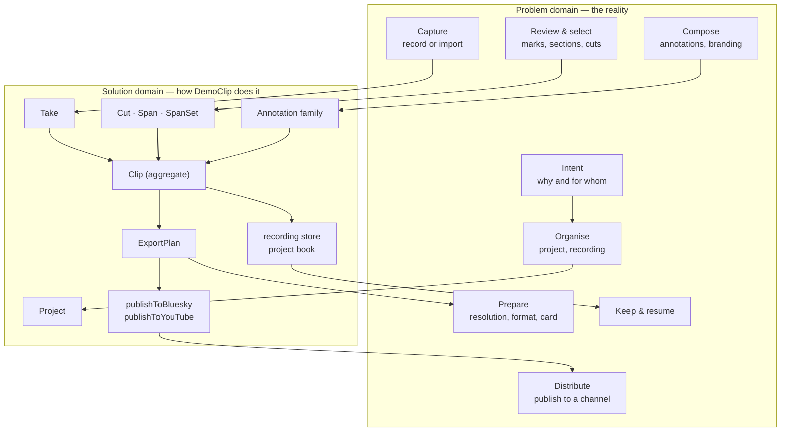

# The DemoClip ontology

One model of the **audiovisual-production domain** DemoClip works in, made so that a
person or an agent can find what matters **before** changing anything.

It is not a second glossary. [`docs/GLOSSARY.md`](../GLOSSARY.md) owns the **words** —
what a take, a cut, an annotation are, and the words we do not use. This directory owns
the **structure**: which concepts exist, how they relate, which layer of reality each
belongs to, what rules hold them, and where each one lives in the code and the specs.
A definition is a **link away, never a copy**, so the two cannot drift.

The reasoning that led here is in [`docs/research/PROBLEM_DOMAIN_MODEL.md`](../research/PROBLEM_DOMAIN_MODEL.md);
this is the artifact that note argues for.

## The two layers

The ontology separates two models that are easy to confuse:

- the **problem domain** — the reality DemoClip operates in: who makes content, why,
  for whom, through which processes, into which channels, under which constraints.
  This is *why the product exists*. It is `problem-domain.md`.
- the **solution domain** — how DemoClip materialises its contribution to that reality:
  the concepts, rules and code it is built from. This is *how the product works*. It is
  `solution-domain.md`.

A solution concept **realises** a problem concept; a problem concept that no solution
concept realises is a gap, and naming it is how the model earns its keep.

## Where to look

| you want to know | read |
|---|---|
| what the app is, and which document owns which fact | `.agents/skills/overview` |
| what a word means | [`docs/GLOSSARY.md`](../GLOSSARY.md) |
| why the app exists, who it is for, what it must do | [`problem-domain.md`](problem-domain.md) |
| how the app models that reality, concept by concept | [`solution-domain.md`](solution-domain.md) |
| what must stay true, and who enforces it | [`rules.md`](rules.md) |
| the graph as data an agent or a tool can query | [`ontology.jsonld`](ontology.jsonld) |
| where a new rule belongs | `.agents/skills/domain-model` |
| how a change is made, and how it is proved | `.agents/skills/project-workflow`, `.agents/skills/verification` |

## The map

## The files

- **`README.md`** — this page: what the ontology is, the two layers, where to look.
- **`problem-domain.md`** — actors, goals, the production lifecycle, the channels, the
  constraints, and what DemoClip does not model.
- **`solution-domain.md`** — DemoClip's concepts, mapped to the problem domain, to the
  four layers of the code, and to the specs; with the concept map and the two lifecycles.
- **`rules.md`** — the invariants and business rules, each with its owner and its proof.
- **`ontology.jsonld`** — the same graph as data: nodes for every concept, edges for the
  relations, the rules and their owners, and the traceability to the code.

## Conventions

- A concept has an **id**: lowercase, kebab-case, unique across both layers (`clip`,
  `production`, `sound-boost`). It is the node's `@id` in the graph and the anchor a
  reference points at.
- The Markdown refers to a concept as **`[[id]]`**. The checker
  (`node tools/check-ontology.mjs`) resolves every reference against the graph, so a
  reference to a concept that does not exist fails rather than misleads.
- **The graph is the machine source; the Markdown is the human view.** A change to the
  concepts, their relations or their traceability starts in `ontology.jsonld` and is
  reflected in the Markdown in the same change. `[[id]]` is the seam between them.
- **The words come first.** A new *word* is added to [`docs/GLOSSARY.md`](../GLOSSARY.md)
  before the code, as always. A new *concept in this model* is added here — a node, and
  a line in the page that explains it — and the two are linked by the id.

## Keeping it alive

The model is meant to grow with the product, not to be finished once. When a change
adds a concept, moves a rule, or opens a gap between what the app does and what the
problem domain asks for, that change updates this model **in the same pull request** —
the graph, the page it belongs on, and the reference from the page that links it. Run
`node tools/check-ontology.mjs` before committing; it fails on a dangling reference or
a malformed graph.
