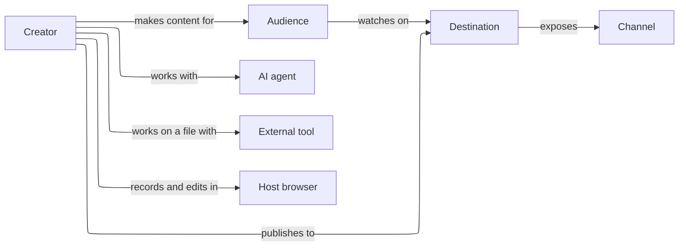
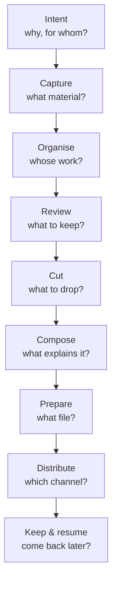

# Problem domain — audiovisual production

The reality DemoClip operates in, described without assuming DemoClip. A person makes
audiovisual content to say something to someone; between the idea and the audience sit a
capture, an edit, a composition, a file and a channel. This page names that reality. How
DemoClip answers it is in [`solution-domain.md`](solution-domain.md).

## Actors

Who is in the picture, and what each one wants.

| id | who | what they want | in DemoClip |
|---|---|---|---|
| [[creator]] | the person producing the content | to say something clearly, without fighting the tools | the person at the app |
| [[audience]] | the person the content is made for | to understand, quickly | not modelled — the destination's viewers |
| [[ai-agent]] | a program that co-produces | to make the same edits a person could, on the same rules | the MCP client, through the [[automation-surface]] |
| [[destination]] | a service that receives and shows content | content in its own format, within its own limits | Bluesky, YouTube |
| [[external-tool]] | software that works on a file outside the app | a standard file it can open, and a way to hand it back | ffmpeg, an editor — reached through the [[sidecar]] round trip |
| [[host-browser]] | the environment the app runs in | — | Chrome and its capture, storage and encoding APIs |

The **audience** is the actor DemoClip models least: the app serves the creator, and the
audience is met at the destination. Naming it here is deliberate — it is the reason every
other actor exists.

## Goals

Why content is produced. A [[production]] names one or more of these in its own words.

| id | goal | a production that serves it |
|---|---|---|
| [[goal-demonstrate]] | show how something works | a feature walkthrough, a bug report |
| [[goal-teach]] | instruct, step by step | a tutorial, a lesson |
| [[goal-report]] | tell what happened | a status update, a changelog |
| [[goal-promote]] | attract an audience to something | a launch clip, a teaser |
| [[goal-archive]] | keep a record | a session capture, a talk |
| [[goal-communicate]] | get an idea across, in general | the umbrella the others sit under |

## The production lifecycle

The stages a piece of content passes through. Each stage is a **process**, and each one
answers a question.

| id | process | the question it answers | the problem concepts it works on |
|---|---|---|---|
| [[process-intent]] | intent | why is this made, and for whom? | [[production]], [[goal-demonstrate]] |
| [[process-capture]] | capture | what material is the content made of? | [[source-material]] |
| [[process-organise]] | organise | which body of work does this belong to? | [[production]] |
| [[process-review]] | review | which moments matter? | [[production-instance]] |
| [[process-cut]] | cutting | what should be dropped? | [[cutting]] |
| [[process-compose]] | compose | what explains the picture? | [[composition]], [[branding]] |
| [[process-prepare]] | prepare | what form does the file take? | [[output]] |
| [[process-distribute]] | distribute | where does it go, and how? | [[publication]], [[channel]] |
| [[process-keep]] | keep & resume | how does work survive an interruption? | [[production-instance]] |

The order is the ordinary one, not a rule: a capture can be imported rather than made,
a composition can happen before a cut, and a clip can be exported and published more than
once. What is a rule is that **an edit precedes an output** — the file holds the decisions
that were made, and nothing downstream re-decides them.

## The things of the domain

The nouns of the reality, before any of them becomes a class.

| id | concept | what it is |
|---|---|---|
| [[production]] | production | a body of work and the reason for it — its goals, in a creator's words |
| [[production-environment]] | production environment | the fixed configuration a way of working needs, so none of it is forgotten or got wrong |
| [[production-instance]] | production instance | one piece of content being made, from its first material to its last output |
| [[source-material]] | source material | the recording or the imported file a production instance is built from |
| [[cutting]] | cutting | the decisions about which stretches of the material are kept |
| [[composition]] | composition | what is laid over the material to explain it — marks, pictures, words, sound |
| [[branding]] | branding | the identity a production wears: its mark, its name, its colour |
| [[output]] | output | the finished file: the kept material, the composition drawn in, one form |
| [[publication]] | publication | the content as delivered to a destination, under that destination's rules |
| [[channel]] | channel | the surface a destination exposes to an audience — an account, a feed |

## Channels and destinations

A **destination** is a service; a **channel** is the part of it content reaches. The
distinction matters because the same production may go to several channels, and each one
imposes its own form and limits.

| destination | the channel | the form it takes | its ceiling |
|---|---|---|---|
| Bluesky | an account's feed | MP4 video, or a post | 10 minutes, 300 MB |
| YouTube | a channel, personal or brand | MP4 video | 256 GB; 15 minutes on a default account |
| a file | — | WebM or MP4 | none — a file is not a channel |

A file is the odd one out on purpose: writing a file is an [[output]], not a
[[publication]]. A destination's limits are the **destination's**, and belong to
[[constraint-destination-limits]], never to the recording.

## Constraints

What must hold for the reality to be served well — some are the domain's, some are the
environment's.

| id | constraint | why it holds |
|---|---|---|
| [[constraint-non-destructive]] | an edit never changes the material | the material is the record; a decision about it must be reversible, and re-encoding it loses what was recorded |
| [[constraint-local-first]] | content stays on the creator's machine unless they publish it | the work is private by default, and the app needs no account or server |
| [[constraint-destination-limits]] | each destination's form and ceiling is honoured before work is spent | a clip too long for a channel should be refused before it is encoded, not after |
| [[constraint-config-consistency]] | a way of working applies the same configuration every time | branding and loudness must not be forgotten, missed or got wrong |
| [[constraint-session-boundary]] | the configuration in force is fixed once capture begins | nothing may move under content already being made |
| [[constraint-browser-capability]] | the app may use only what the host browser gives it | the app is client-only; capture, storage and encoding are the browser's |

## What DemoClip does not model

The gaps are part of the model: naming them is what tells a future development where to
look. Each is a [[production]] concern no solution concept realises yet.

- **A structured recording plan.** A [[production]] carries a free-text description; the
  [[process-intent]] it stands for — the goals, the audience, the outline — has no shape
  of its own. The glossary calls the description a stand-in for a recording plan "until a
  structured one exists".
- **The audience.** Content is made for someone, and nothing in the app says who.
- **Several creators on one production.** Collaboration and approval are absent; there is
  one person and, optionally, one agent.
- **Adapting one production to several channels at once.** Each [[output]] is written on
  its own; nothing derives a channel's variant from a single composition.
- **A destination beyond Bluesky and YouTube.** The [[channel]] is modelled per
  destination, not as one thing with several implementations.
