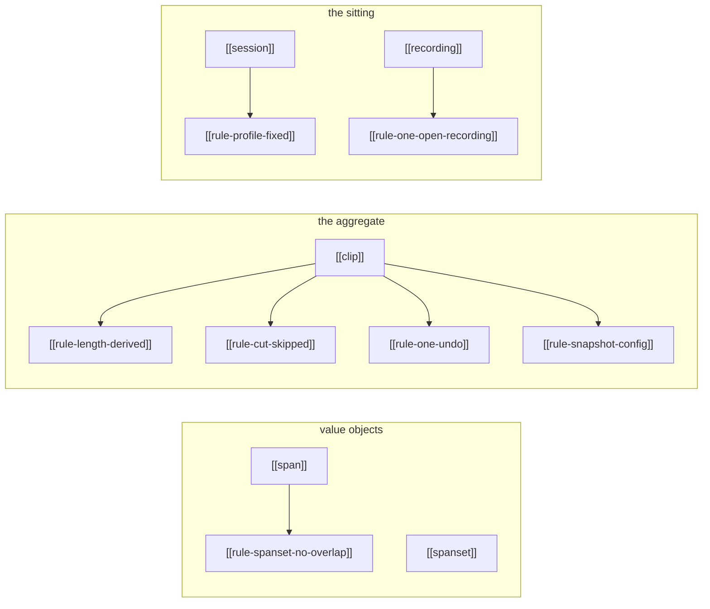

# Rules — what must stay true

The invariants and business rules of the domain, each with **the concept that owns it**
and **how it is proved**. A rule belongs to the one thing that can enforce it — about a
range, the value object; about the clip as a whole, the aggregate; about a take, `Take`;
about the browser, an adapter. Prefer *cannot be represented* to *must remember to check*.

The full statement of a rule is in its owner's code and test; the words are in
[`docs/GLOSSARY.md`](../GLOSSARY.md). This page is the **index**: what holds, who owns it,
and where the proof is.

## Invariants

| id | what must stay true | owner | proof |
|---|---|---|---|
| [[rule-length-derived]] | a clip's length is the sum of its takes, derived and never a field beside them | [[clip]] | `Clip.test.ts` |
| [[rule-spanset-no-overlap]] | the cut ranges never overlap | [[spanset]] | `SpanSet.test.ts` |
| [[rule-take-has-length]] | a take cannot be built without a length, and its length cannot be zero | [[take]] | `Take.test.ts` |
| [[rule-even-edges]] | the clip size and the export resolution are even in both dimensions | [[clip-size]] | `ClipSize.test.ts` |
| [[rule-annotation-fractions]] | an annotation's geometry is in fractions of the picture, so it lands the same on the preview, in the file and after a reload | [[annotation]] | `Annotation.test.ts` |
| [[rule-watermark-own-property]] | each watermark part follows its own clip property: the mark the logo, the line the title | [[watermark]] | `watermark` tests |
| [[rule-recording-one-project]] | a recording belongs to exactly one project at all times | [[recording]] | the stored record's shape |
| [[rule-one-open-recording]] | at most one recording is open; every other is finished | [[open-pointer]] | `Recordings` tests |
| [[rule-state-derived]] | in progress and finished are derived from the session, never stored as a flag | [[recording]] | `Recordings.list()` |
| [[rule-default-project-immune]] | the Default project can be neither renamed nor removed | [[projects-book]] | `Projects.test.ts` |
| [[rule-default-profile-immune]] | the built-in Empty profile declares nothing and is never renamed or removed | [[profile]] | `Profiles.test.ts` |

## Business rules

| id | the rule | owner | proof |
|---|---|---|---|
| [[rule-cut-skipped]] | a cut is *skipped* by playback and the export; the recording's bytes are never re-encoded, which is what makes one undo enough | [[clip]] | `ExportPlan` / `Clip` tests |
| [[rule-one-undo]] | one undo takes back the person's last change, and never puts back a value a profile is holding | [[clip]] | `Clip.test.ts` |
| [[rule-profile-fixed]] | a profile may be chosen until the session begins to capture, and is fixed from then until it ends; its declarations are frozen too | [[session]] | `specs/016-projects` |
| [[rule-snapshot-config]] | a recording keeps the profile **snapshot** it was made under; editing or removing the profile later never reaches it | [[clip-profile]] | `ClipProfile` tests |
| [[rule-controlled-item-locked]] | an item the active profile declares is applied and not the person's to change | [[controlled-item]] | `ui/profile/control.ts` |
| [[rule-export-offline]] | the export encodes offline, faster than real time, and does not play; the file carries a duration and cues | [[export-plan]] | `specs/013-export-resolution` |
| [[rule-destination-limits-first]] | a destination's ceiling is refused **before** a frame is encoded, never after minutes of work | [[uploadable-video]] | `UploadableVideo.test.ts` |
| [[rule-sound-only-refused]] | a video destination refuses a sound-only clip; its sound is a file, not a post | [[publish-to-youtube]] | `publish-to-youtube` tests |
| [[rule-title-defaulted]] | a video title left blank is defaulted, never uploaded empty | [[video-details]] | `VideoDetails.test.ts` |
| [[rule-private-first]] | visibility is sent explicitly and starts private, because an unset one means public | [[visibility]] | `Visibility.test.ts` |
| [[rule-no-account-read]] | the app asks for the upload scope alone, so it reads nothing about a person's account | [[publish-to-youtube]] | `specs/007-youtube-export` |
| [[rule-sidecar-same-length]] | a sidecar is taken only while the lengths agree; a file of another length is another clip | [[sidecar]] | `AnnotationSidecar.test.ts` |
| [[rule-agent-no-destruction]] | the agent's tool list contains no deletion and no project removal — those need the person's confirmation | [[mcp-server]] | `mcp/src/tools.ts` |
| [[rule-sound-only-export]] | a clip whose kept stretches have no picture writes the sound alone, in the same two containers, with no video track | [[clip]] | `specs/011-record-audio-only` |

## Rules of the codebase

Not domain rules, but rules a change here must keep. They are owned by the architecture,
and the constitution names them.

| id | the rule | proof |
|---|---|---|
| [[rule-domain-pure]] | `src/domain/` imports no DOM, no browser API, and nothing from `ui/` or `infra/` | `eslint` / review |
| [[rule-one-place]] | a rule lives in one place, and everything asks it — two copies drift | review; the export once drew in a different order from the review |
| [[rule-view-listens]] | the clip announces what changed and the modules that draw it react; a caller does not re-render around the call | `.agents/skills/domain-model` |
| [[rule-message-translated]] | every message a person can see is a translation key, added to `en_UK.ts` and `es_ES.ts` together | `catalogs.test.ts` |
| [[rule-words-first]] | a new word is written into the glossary before it appears in code | `.agents/skills/domain-model` |
| [[rule-tests-with-the-rule]] | a rule in `src/domain/` has a unit test beside it; anything drawn needs a browser check | `.agents/skills/verification` |

## Adding a rule

1. Name it here and in the graph — a `rule-…` node with its `owner` and its `proof`.
2. Put it where it can be enforced: the value object, the aggregate, the take, the port.
3. Prove it at the level the change needs (`.agents/skills/verification`).
4. If it changes a word, change the word in [`docs/GLOSSARY.md`](../GLOSSARY.md) in the
   same pull request.
