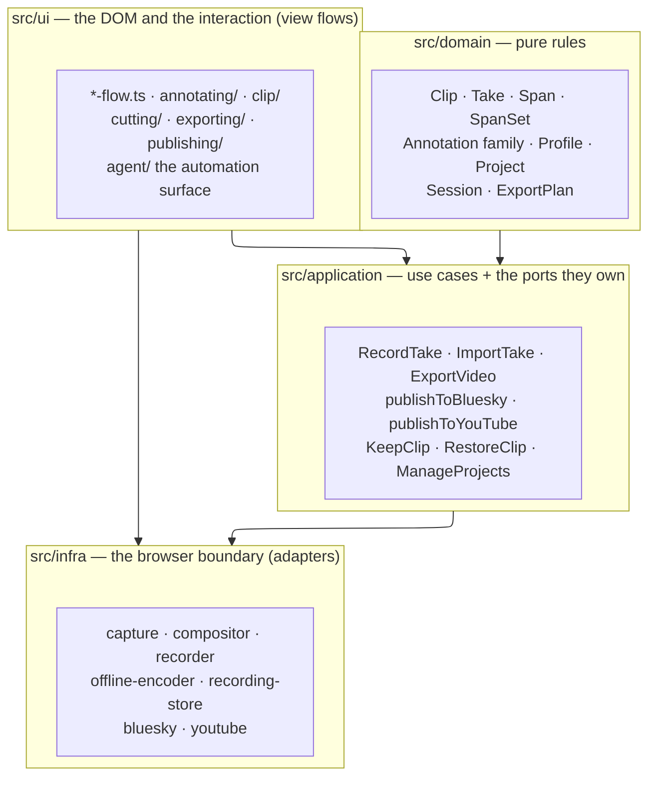
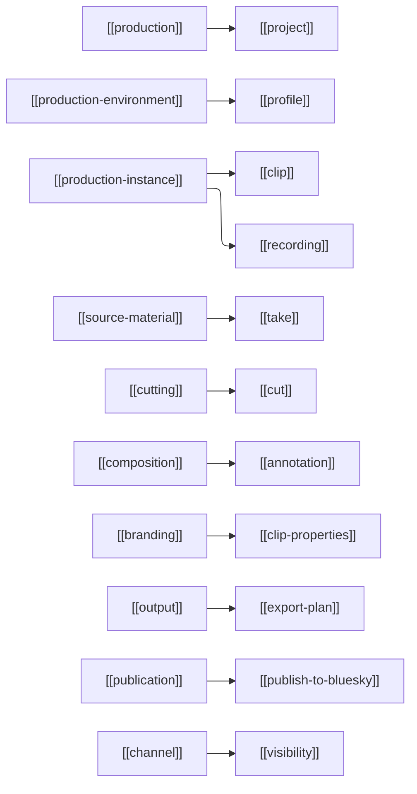
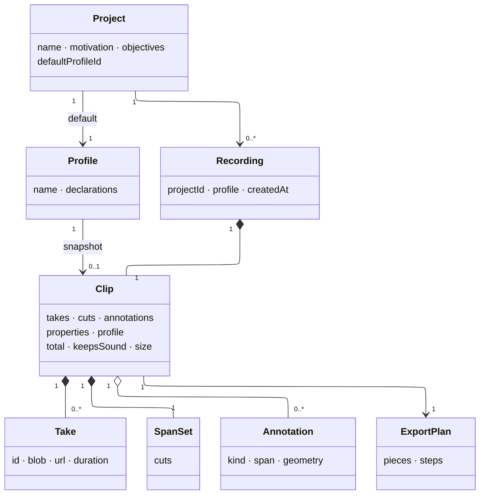
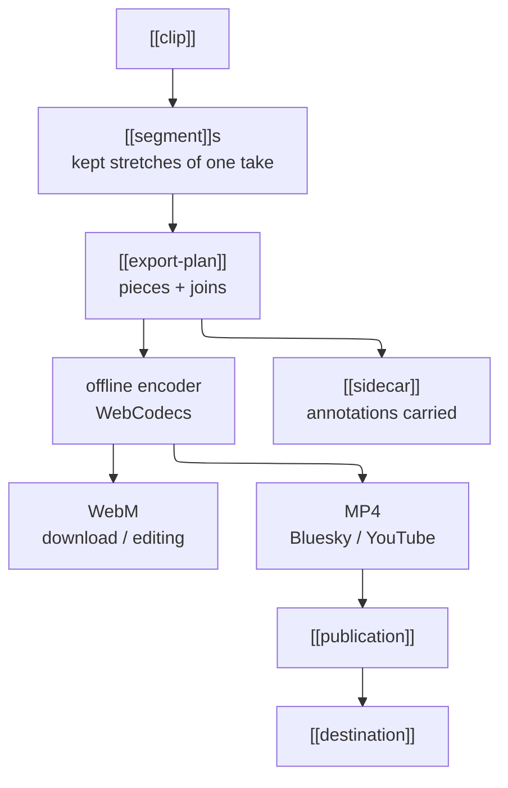
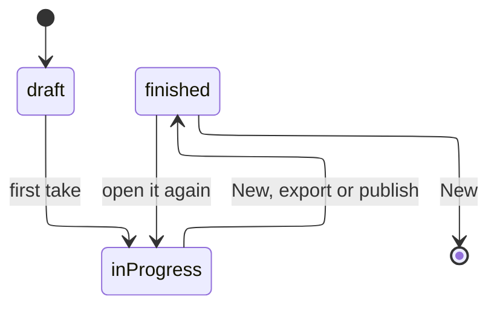
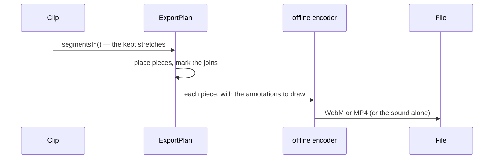

# Solution domain — how DemoClip models it

DemoClip's own concepts, placed against the [problem domain](problem-domain.md). A word
here is defined in [`docs/GLOSSARY.md`](../GLOSSARY.md) — this page gives its **role in the
model** and **where it lives in the code**, and how it **realises** the reality. Where a
rule belongs is in `.agents/skills/domain-model`; the rules themselves are in
[`rules.md`](rules.md).

## The four layers

The dependency arrow points inward. A concept's home follows from what it is.

| layer | what it holds | a rule here is… |
|---|---|---|
| `src/domain/` | pure rules; no DOM, no browser API, no import from `ui/` or `infra/` | a **class** named after the word, tested beside it |
| `src/application/` | use cases and the **ports** they own; runs in node with fakes | a sequence that delivers an outcome |
| `src/infra/` | **adapters**: the browser capability behind a port | the implementation of a capability |
| `src/ui/` | the DOM and the interaction; **view flows** sequence, and hold no rule | the sequencing that depends on the browser |

The rule of thumb: **about a range → the value object; about the clip as a whole → the
aggregate; about a take → `Take`; about the browser → an adapter or a flow.** The view
**listens**: the clip announces what changed and the modules that draw it react.

## Traceability — which solution concept realises which reality

| problem concept | realised by | where |
|---|---|---|
| [[production]] | [[project]], [[projects-book]] | `src/domain/project/` |
| [[production-environment]] | [[profile]], [[clip-profile]] | `src/domain/profile/` |
| [[production-instance]] | [[clip]], [[recording]], [[session]] | `src/domain/clip/Clip.ts`, `src/domain/session/Session.ts` |
| [[source-material]] | [[take]], [[take-file]], [[take-repository]] | `src/domain/clip/Take.ts` |
| [[cutting]] | [[cut]], [[span]], [[spanset]], [[selection]] | `src/domain/clip/Span.ts`, `SpanSet.ts` |
| [[composition]] | [[annotation]] and its kinds, [[annotation-plugin]] | `src/domain/annotation/`, `src/ui/annotating/` |
| [[branding]] | [[logo]], [[watermark]], [[title-card]], [[annotation-colour]] | `src/ui/clip/clip-properties.ts` |
| [[output]] | [[export-plan]], [[export-target]], [[export-resolution]] | `src/domain/clip/ExportPlan.ts` |
| [[publication]] | [[publish-to-bluesky]], [[publish-to-youtube]] | `src/application/publish-*.ts` |
| [[channel]] | [[visibility]], [[uploadable-video]], [[bluesky-post]] | `src/domain/youtube/`, `src/domain/bluesky/` |
| [[ai-agent]] | [[automation-surface]], [[mcp-server]] | `src/ui/agent/`, `mcp/` |
| [[external-tool]] | [[sidecar]], [[import-take]] | `src/domain/clip/AnnotationSidecar.ts` |

## The concept map

The aggregate and its parts, and the things beside it.

A `Recording` **names** its project rather than being held by it, so the two can never
disagree. A `Clip` **is** the aggregate: the only thing that knows what the clip is.

## Production — the clip and its material

| id | concept | role in the model | code |
|---|---|---|---|
| [[session]] | session | one sitting: the clip, and whether capture has begun; ends at New, an export or a publish | `domain/session/Session.ts` |
| [[clip]] | clip | the aggregate: the takes, the cuts, the annotations, what it says about itself | `domain/clip/Clip.ts` |
| [[take]] | take | one arrival of material: a press of Record, or an import; its own length, picture and sound | `domain/clip/Take.ts` |
| [[take-file]] | take file | a WebM or MP4 chosen to import — the two containers the export reads back | `domain/clip/TakeFile.ts` |
| [[import-take]] | import | a take file read and appended as a take; nothing re-recorded | `application/import-take.ts` |
| [[take-repository]] | take repository | the port the clip takes its takes from; the only owner of their object URLs | `domain/clip/TakeRepository.ts` |
| [[source-set]] | source set | which of screen, webcam and microphone are on; all off at start | `domain/capture/SourceSet.ts` |
| [[crop-region]] | crop region | the rectangle of the screen being recorded, as fractions | `domain/capture/CropRegion.ts` |
| [[webcam-bubble]] | webcam bubble | where and how big the camera sits over the picture; per sitting, never kept | `domain/capture/WebcamBubble.ts` |
| [[clip-size]] | clip size | the picture the clip is worked in, derived from the takes, never set | `domain/clip/ClipSize.ts` |

## Editing — ranges, marks and cuts

| id | concept | role in the model | code |
|---|---|---|---|
| [[span]] | span | a half-open range `[s, e)`: the smallest thing a timeline is made of | `domain/clip/Span.ts` |
| [[spanset]] | span set | ranges that cannot overlap — what was cut | `domain/clip/SpanSet.ts` |
| [[cut]] | cut | a section that was approved: it leaves the timeline, and playback and the export skip it | `Clip.cuts` |
| [[mark]] | mark | a position placed by a click; view state, not the clip's | `ui/cutting/selection.ts` |
| [[section]] | section | the stretch two marks bound — a proposal, nothing has left the clip | `ui/cutting/selection.ts` |
| [[selection]] | selection | the stretch the user is pointing at, and the action chosen for it | `ui/cutting/selection.ts` |
| [[timeline-map]] | timeline map | the only place that converts between recording time and kept time | `domain/clip/TimelineMap.ts` |

`TimelineMap` exists because passing one time for the other is the mistake to prevent;
the two times are the [[production-instance]]'s, and the map is the seam.

## Composition — the annotation family

A kind is **a class plus a plugin**: its rules in the domain, its look and its making in
the view, under the same id. Adding a kind is a class, a line in the register, and a
plugin — picking, moving, resizing, copying, deleting and undoing come for free.

| id | concept | role in the model | code |
|---|---|---|---|
| [[annotation]] | annotation | something drawn over the picture for a stretch of the clip's time | `domain/annotation/Annotation.ts` |
| [[annotation-kind]] | annotation kind | what makes one annotation different: its rules, normalisation and hit test | `domain/annotation/kinds.ts` |
| [[annotation-plugin]] | annotation plugin | a kind in the view: its action, renderer and how a new one is made | `ui/annotating/annotation-plugin.ts` |
| [[annotation-canvas]] | annotation canvas | the one shared editing surface every kind gets, naming no kind | `ui/annotating/annotation-canvas.ts` |
| [[annotation-layer]] | annotation layer | the one place an annotation is drawn — by playback and by the export alike | `ui/annotating/annotation-layer.ts` |
| [[annotation-lane]] | annotation lane | the timeline row where each annotation is found, in kept time | `ui/annotating/annotation-lane.ts` |
| [[properties-inspector]] | properties inspector | the one surface that edits a picked annotation's properties | `ui/annotating/properties-inspector.ts` |
| [[arrow]] | arrow | the first kind: a line with a head, given by `from` and `to` | `domain/annotation/Arrow.ts` |
| [[image-annotation]] | image annotation | a chosen picture over the picture, a rect keeping proportions | `domain/annotation/ImageAnnotation.ts` |
| [[text-annotation]] | text annotation | a line of text over the picture, a box that scales with its font | `domain/annotation/TextAnnotation.ts` |
| [[sound-annotation]] | sound annotation | a stock sound over a stretch, mixed with the recorded sound | `domain/annotation/SoundAnnotation.ts` |
| [[magnifier]] | magnifier | a lens over a detail, showing it enlarged and dimming the rest | `domain/annotation/Magnifier.ts` |

A **sound annotation** is the kind that is heard and not drawn; a **magnifier** is the
kind that reads the picture beneath it. Both are ordinary kinds in every other way.

## What a clip says about itself — branding

| id | concept | role in the model | code |
|---|---|---|---|
| [[clip-properties]] | clip properties | what the clip says about itself, declared by the app and kept with the clip | `domain/clip/ClipProperties.ts` |
| [[clip-property]] | clip property | one of them: a label, a control, and how to read and write the value | `ui/clip/clip-properties.ts` |
| [[logo]] | logo | a mark the app serves, worn on the title card and as a watermark | `ui/logos.ts` |
| [[watermark]] | watermark | the logo and title as annotations over the whole clip | `ui/clip/watermark.ts` |
| [[title-card]] | title card | the head an export puts on a file: the first frame held, with the clip's words | `domain/clip/IntroCard.ts` |
| [[annotation-colour]] | annotation colour | the colour a new annotation is made in; a profile may fix it | `domain/annotation/AnnotationColour.ts` |
| [[export-resolution]] | export resolution | the size the file is written at; the clip size scaled by one factor | `domain/clip/ExportResolution.ts` |

## Profiles and projects — the context of production

| id | concept | role in the model | code |
|---|---|---|---|
| [[profile]] | profile | a named set of the app's configuration a person works under; a production environment | `domain/profile/Profile.ts` |
| [[active-profile]] | active profile | the one profile in force; fixed once capture begins | `domain/profile/Profiles.ts` |
| [[declaration]] | declaration | what a profile says about one item — that it controls it, and its value | `domain/profile/Profile.ts` |
| [[controlled-item]] | controlled item | an item the active profile declares: applied and locked, not the person's | `ui/profile/control.ts` |
| [[clip-profile]] | clip profile | the profile a recording was made under, snapshotted at capture | `domain/clip/ClipProfile.ts` |
| [[project]] | project | a body of work and its reason: name, description, default profile | `domain/project/Project.ts` |
| [[projects-book]] | project book | where the projects outlive the page: localStorage | `infra/project-store.ts` |
| [[recording]] | recording | a clip that belongs to a project, with the profile it was made under | `application/recordings.ts` |
| [[recording-store]] | recording store | where recordings outlive the page: IndexedDB, keyed by recording | `infra/recording-store.ts` |
| [[open-pointer]] | open pointer | which recording the sitting is on; written with a recording's first meta | `infra/recording-store.ts` |

## Output and distribution

| id | concept | role in the model | code |
|---|---|---|---|
| [[segment]] | segment | a kept stretch of one take: `{ takeIndex, from, to }` | `Clip.segmentsIn()` |
| [[export-plan]] | export plan | the kept stretches placed on the output timeline, with the joins — decided before a frame is encoded | `domain/clip/ExportPlan.ts` |
| [[export-target]] | export target | which container an export writes, and the picture the encoder is given | `domain/export/ExportTarget.ts` |
| [[fade]] / [[dissolve]] | fade / dissolve | the sound down and up, and the picture blending, over a join | `ui/clip/fade.ts`, `dissolve.ts` |
| [[sidecar]] | sidecar | the annotations written beside a file, so a clip that leaves comes back whole | `domain/clip/AnnotationSidecar.ts` |
| [[publication]] | publication | the clip going to a destination: write, upload, wait, post | `application/publish-to-bluesky.ts` |
| [[publish-to-bluesky]] | publish to Bluesky | the first destination: an OAuth session and XRPC calls behind a port | `application/publish-to-bluesky.ts` |
| [[publish-to-youtube]] | publish to YouTube | the second destination: Google's token model and a resumable upload | `application/publish-to-youtube.ts` |
| [[bluesky-post]] | Bluesky post | the `app.bsky.feed.post` record carrying the video embed | `domain/bluesky/BlueskyPost.ts` |
| [[uploadable-video]] | YouTube video | the MP4 the app sends YouTube, with the destination's ceilings | `domain/youtube/UploadableVideo.ts` |
| [[video-details]] | video details | the title (defaulted when blank), description and visibility | `domain/youtube/VideoDetails.ts` |
| [[visibility]] | visibility | who may see the video: private, unlisted or public; private where it starts | `domain/youtube/Visibility.ts` |
| [[upload]] | upload | the transfer of the bytes: a resumable session, watched by the byte | `infra/youtube.ts` |

## Being driven by an agent

The agent reaches the app through its own operations and nothing else, so the model an
agent works on is the model a person works on.

| id | concept | role in the model | code |
|---|---|---|---|
| [[automation-surface]] | automation surface | the app's own operations in one object, published only when the page asks | `ui/agent/surface.ts` |
| [[operation]] | operation | one thing an agent may do, named in the app's vocabulary | `ui/agent/` |
| [[mcp-server]] | MCP server | the local program that opens the browser and offers the surface as tools | `mcp/` |
| [[agent-session]] | agent session | one sitting driven by an agent: the browser, the clip, and the person watching | `mcp/src/server.ts` |

## The two lifecycles

**The recording lifecycle** — derived, never stored as a flag:

**The export pipeline** — the same answer for the review and every file:

Both are in [`rules.md`](rules.md) as the invariants they rest on.
